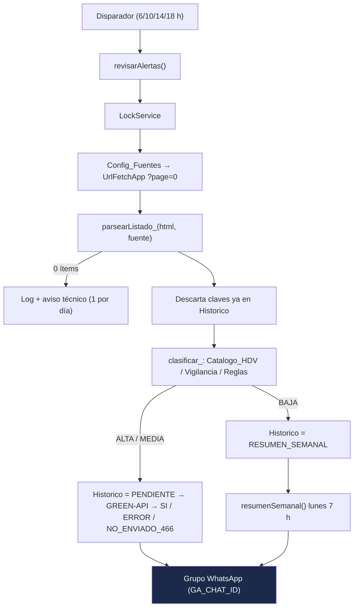

# Alertas WhatsApp - Alertas sanitarias INVIMA HDV

Bot de Google Apps Script (`alertas-sanitarias-invima-hdv`) del Servicio Farmacéutico del Hospital Departamental de Villavicencio E.S.E. Revisa los listados de alertas sanitarias e informes de seguridad de INVIMA (medicamentos y dispositivos médicos), los clasifica según su relevancia para el HDV y publica las relevantes en el grupo de WhatsApp vía [GREEN-API](https://green-api.com/).

Proyecto hermano de [alertas-whatsapp-farmacovigilancia](https://github.com/jsaavedran1-glitch/alertas-whatsapp-farmacovigilancia): misma instancia GREEN-API (`710722693364`), Script Properties independientes.

## Arquitectura

- **Proyecto:** Apps Script independiente (standalone), propiedad de `controldecalidadgases@hdv.gov.co`. Sin clasp (misma convención que el bot de Farmacovigilancia): el código se copia de `Codigo.gs` al editor.
- **Hoja de control:** Google Sheets indicada en `SS_ID`.
- **Fuentes:** HTML del servidor (Drupal Views) de `app.invima.gov.co/alertas/...`. En operación normal solo se lee `?page=0`.
- **Disparadores:** `revisarAlertas` diario a las 6, 10, 14 y 18 h; `resumenSemanal` los lunes a las 7 h (America/Bogota, ±15 min).



## Archivos

| Archivo | Descripción |
|---|---|
| `Codigo.gs` | Lógica completa del bot. |
| `appsscript.json` | Manifiesto: `America/Bogota`, V8, scopes mínimos (`script.external_request`, `spreadsheets`, `script.scriptapp`). |
| `test/dry-run.js` | Pruebas en Node.js con servicios de Apps Script simulados y HTML real de ejemplo. Sin red ni credenciales. |
| `package.json` | `npm test` ejecuta `test/dry-run.js` (usado por el workflow Node.js CI). |
| `CLAUDE.md` | Reglas operativas para asistentes de IA. |
| `CHANGELOG.md` | Historial de cambios. |

## Propiedades del script requeridas

Configuración del proyecto → Propiedades de las secuencias de comandos:

| Propiedad | Descripción |
|---|---|
| `GA_API_URL` | URL base de la instancia GREEN-API (p. ej. `https://7107.api.greenapi.com`). |
| `GA_ID` | ID de la instancia (`710722693364`). |
| `GA_TOKEN` | Token de la instancia. **Secreto: no versionar, no compartir.** |
| `GA_CHAT_ID` | chatId del grupo destino (debe terminar en `@g.us`; el código bloquea cualquier otro). Durante las pruebas: grupo "PRUEBA BOT". En producción: grupo "HDV-Nuevo servicio". |
| `SS_ID` | ID de la hoja de control (`1rN_yIfqk1388zqUBr-P0zfbTBiSVlDDl-D44INlXsgo`). |

`ULTIMO_AVISO_TECNICO` la crea el bot (fecha del último aviso de listado ilegible).

## Despliegue y orden de ejecución inicial

1. En [script.google.com](https://script.google.com) con `controldecalidadgases@hdv.gov.co`, abrir el proyecto `alertas-sanitarias-invima-hdv`.
2. Mostrar `appsscript.json` (Configuración del proyecto) y pegar su contenido; pegar `Codigo.gs`. Guardar.
3. Cargar las propiedades del script (tabla anterior), con `GA_CHAT_ID` = PRUEBA BOT.
4. Ejecutar, en este orden, verificando en el selector la función antes de pulsar "Ejecutar":
   1. **`inicializarHoja()`**: crea las pestañas con encabezados; precarga `Config_Fuentes` y `Reglas`. No modifica pestañas que ya tienen datos.
   2. Cargar `Catalogo_HDV` y `Vigilancia` en la hoja.
   3. **`cargaInicial()`**: lee 5 páginas por fuente y llena el `Historico` con `enviado = CARGA_INICIAL`, **sin enviar mensajes**. Evita que el primer día se disparen alertas viejas. **Obligatorio antes de activar disparadores.**
   4. **`probarSinEnviar()`**: ejecuta todo el flujo y escribe los mensajes en el registro de ejecución (`[SIMULADO - no enviado]`), sin enviar ni escribir en `Historico`. Incluye el texto del resumen semanal.
   5. **`instalarDisparadores()`**: borra los disparadores del proyecto y crea los del bot.
5. Pasar a producción: cambiar `GA_CHAT_ID` al grupo "HDV-Nuevo servicio" (solo con autorización explícita del referente).

## Hoja de control

| Pestaña | Columnas | Quién la llena |
|---|---|---|
| `Config_Fuentes` | fuente, url, activa | Precargada (MED, DM). Editable. |
| `Historico` | clave, fuente, numero, anio, titulo, tipo, fecha_publicada, url_pdf, fecha_deteccion, nivel, coincidencia, enviado | El bot. |
| `Catalogo_HDV` | codigo, descripcion, principio_activo, marca, tipo (MED/DM) | El referente. |
| `Reglas` | termino, nivel (ALTA/MEDIA/BAJA) | Precargada. Editable. |
| `Vigilancia` | principio_activo | El referente (antimicrobianos PROA, control especial). |
| `Log` | fecha, fuente, leidos, nuevos, enviados, estado, error | El bot. |

Valores de `enviado`: `SI`, `PENDIENTE` (se escribe antes de enviar), `ERROR`, `NO_ENVIADO_466`, `RESUMEN_SEMANAL` (BAJA), `CARGA_INICIAL`. Ninguna clave se reintenta: si queda `ERROR` o `NO_ENVIADO_466`, revisarla manualmente.

## Reglas de negocio

- **Clave única:** `FUENTE:TIPO:NUMERO-AÑO`, con TIPO `AS` (alerta sanitaria) o `IS` (informe de seguridad), p. ej. `MED:AS:330-2026`, `DM:IS:148-2026`. El número se extrae del nombre del PDF (`No_ #355-2026`). Si no hay número, la clave es `FUENTE:url_pdf`.
- **La fecha del listado no es confiable** (alertas 2026 con fecha 2016-10-14): nunca se filtra por fecha.
- **Clasificación** (mayúsculas, sin tildes, por palabras completas, sobre el título):
  - 🔴 **ALTA:** coincide con `principio_activo` o `marca` de `Catalogo_HDV` (del mismo tipo MED/DM, o sin tipo), con `Vigilancia`, o con una regla ALTA.
  - ⚪ **BAJA:** contiene un término BAJA y no tiene coincidencias ALTA.
  - 🟠 **MEDIA:** contiene un término MEDIA, o es un informe de seguridad.
  - ⚪ **BAJA:** el resto.
  - En catálogo y Vigilancia se ignoran términos de menos de 4 caracteres (evita falsos positivos). En `Reglas` no hay mínimo (p. ej. `CBD`).
- **Envío:** ALTA y MEDIA de inmediato (ALTA primero), 2 s entre mensajes, máximo 10 por ejecución; si hay más, un único mensaje agrupado `[INVIMA]`. BAJA solo en el resumen semanal.
- **Listado ilegible** (HTTP ≠ 200 o 0 ítems en `page=0`): fila de error en `Log` y un aviso `[INVIMA] ⚠️ No se pudo leer el listado` como máximo una vez al día.
- **GREEN-API:** solo `sendMessage` a `GA_CHAT_ID`. No se usan `checkWhatsapp` ni `getContacts`. Ante HTTP 466 (cuota) se registra en `Log` y no se intenta ningún otro envío en esa ejecución.

## Formato del mensaje

```
[INVIMA-DM] 🔴 Informe de seguridad No. 149-2026
Informe de seguridad sobre: Cementos óseos con gentamicina Heraeus® ... PALACOS® R+G...
Tipo: Informe de seguridad | Publicada: 2026-10-19
ID INVIMA: DI2609-00541 | Estado: SEGUIMIENTO      (solo DM)
Coincidencia HDV: Cemento óseo con gentamicina (DM-0457)      (si aplica)
PDF: https://app.invima.gov.co/alertas/ckfinder/userfiles/files/...
```

## Cómo agregar fuentes o reglas

- **Fuente nueva:** agregar una fila en `Config_Fuentes` (`fuente` corta en mayúsculas, p. ej. `COS`; `url` del listado sin `?page`; `activa` = `SI`). El prefijo del mensaje será `[INVIMA-COS]`. Antes, comprobar el listado con `probarAcceso()`/`volcarMuestraHtml()` y ejecutar `cargaInicial()` para no disparar el histórico de esa fuente. Para desactivar una fuente: `activa` = `NO`.
- **Regla nueva:** fila en `Reglas` con `termino` y `nivel`. Se aplica en la siguiente ejecución.
- **Medicamento o dispositivo del HDV:** fila en `Catalogo_HDV`. **Vigilancia:** fila en `Vigilancia`.

## Funciones

| Función | Uso | ¿Envía WhatsApp? |
|---|---|---|
| `inicializarHoja()` | Crea pestañas y encabezados | No |
| `cargaInicial(paginas = 5)` | Pobla `Historico` sin enviar | No |
| `probarSinEnviar()` | Flujo completo simulado | No |
| `instalarDisparadores()` | Recrea los disparadores | No |
| `revisarAlertas()` | Función principal | **Sí** |
| `resumenSemanal()` | Resumen semanal | **Sí** |
| `probarAcceso()`, `volcarMuestraHtml()` | Diagnóstico del sitio INVIMA | No |

## Pruebas locales

```bash
npm test
```

## Alcance

Exclusivo HDV E.S.E. (Villavicencio). Esta versión no descarga ni analiza el contenido de los PDF. Marco: Resolución 4816 de 2008 (tecnovigilancia), programa de farmacovigilancia, alertas sanitarias INVIMA.
