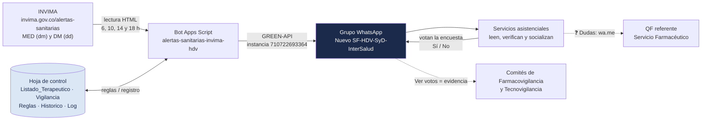
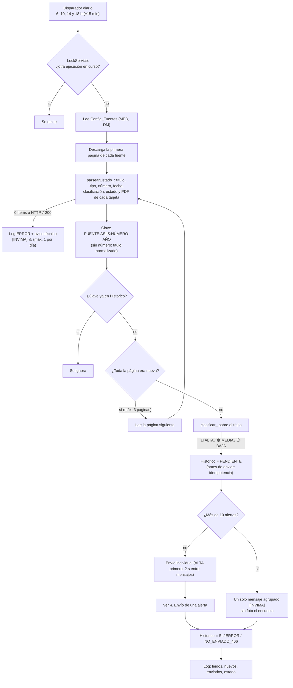
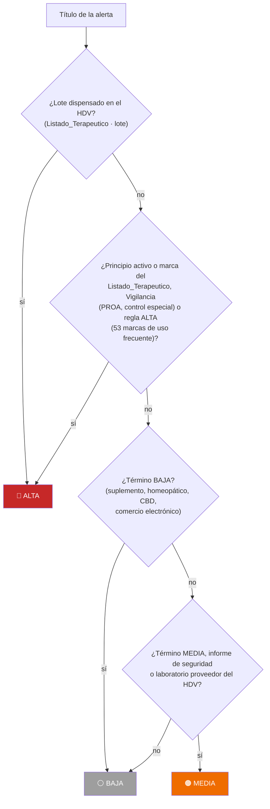
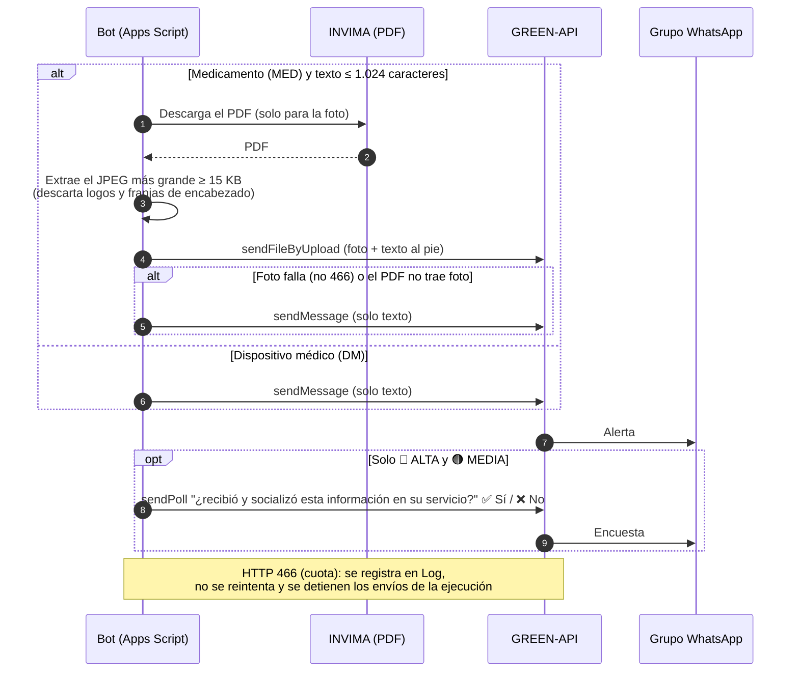
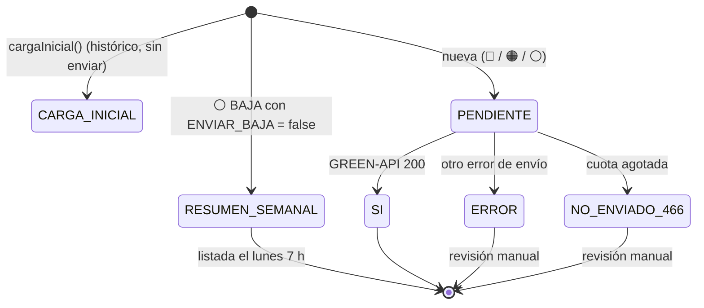

# Alertas WhatsApp - Alertas sanitarias INVIMA HDV

Bot de Google Apps Script (`alertas-sanitarias-invima-hdv`) del Servicio Farmacéutico del Hospital Departamental de Villavicencio E.S.E. Revisa los listados de alertas sanitarias e informes de seguridad de INVIMA (medicamentos y dispositivos médicos), los clasifica según su relevancia para el HDV y publica las relevantes en el grupo de WhatsApp vía [GREEN-API](https://green-api.com/).

Proyecto hermano de [alertas-whatsapp-farmacovigilancia](https://github.com/jsaavedran1-glitch/alertas-whatsapp-farmacovigilancia): misma instancia GREEN-API (`710722693364`), Script Properties independientes.

> **Estado: en operación.** `Codigo.gs` es la copia del proyecto vivo `alertas-sanitarias-invima-hdv` (sincronizada el 2026-10-20). Puesta en marcha: `inicializarHoja()` → `cargaInicial()` → `probarSinEnviar()` → `instalarDisparadores()`. Operación por disparador: `revisarAlertas()` (6, 10, 14 y 18 h) y `resumenSemanal()` (lunes 7 h).

## Encuesta de socialización

Después de cada alerta enviada de forma individual, el bot envía al mismo grupo una encuesta de WhatsApp (`sendPoll` de GREEN-API, una sola respuesta):

```
🔴 Alerta sanitaria No. 329-2026 (MED): ¿recibió y socializó esta información en su servicio?
( ) ✅ Sí
( ) ❌ No
```

- El círculo de color es el nivel de la alerta (🔴 ALTA, 🟠 MEDIA); los informes de seguridad dicen "Informe de seguridad No. …".
- WhatsApp exige al menos 2 opciones. Se configuran en `OPCIONES_ENCUESTA` (máximo 12, distintas entre sí); `ENCUESTA_ACTIVA = false` la apaga.
- No se envía si la alerta falló, ni con el mensaje agrupado (más de `MAX_MENSAJES` alertas en una ejecución), ni en `probarSinEnviar()` (allí solo se registra). `enviarPruebaAlerta()` sí la envía, para verlo en PRUEBA BOT.
- Cuota: la instancia está en el plan Developer (gratis) de GREEN-API, que no limita mensajes sino **chats distintos por mes (3, contando entrantes; se reinicia el día 1)**. La encuesta va al mismo grupo que la alerta, así que no consume cupo de chats. Esta instancia es compartida con los bots de Farmacovigilancia, Tecnovigilancia y PROA y usa 2 de los 3 chats (grupo de producción y PRUEBA BOT): cualquier chat adicional, incluido alguien que le escriba al número del bot por privado, puede agotar el cupo y producir el error 466 hasta el día 1.
- Si la encuesta falla, la alerta sigue marcada como enviada; si responde 466, se detienen los envíos siguientes de esa ejecución.
- Las respuestas se ven en el propio WhatsApp; el bot no las lee ni las registra en la hoja.

Pruebas locales: `npm test` (incluye `test/encuesta.js`, sin red ni credenciales).

## Flujo de funcionamiento

### 1. Vista general

De la publicación de INVIMA a la evidencia de socialización en los servicios del HDV.



### 2. Revisión de alertas (`revisarAlertas`, cada disparador)



### 3. Clasificación (`clasificar_`)

Se compara el **título** del listado (mayúsculas, sin tildes, palabras completas, tolerando plurales) contra la hoja de control:



La coincidencia que justifica el nivel va en el mensaje (`🏥 Coincidencia HDV`), p. ej. `Lote F0537A dispensado en HDV`, `Vigilancia: GENTAMICINA` o `Uso frecuente: BUSCAPINA`.

### 4. Envío de una alerta al grupo



Mensaje que llega al grupo:

```
[foto del producto, solo MED]
[INVIMA-MED] 🔴 *PRIORIDAD ALTA* · 💊 Medicamento
*Alerta sanitaria No. 329-2026*

📌 FALSIFICACIÓN DEL PRODUCTO BUSCAPINA® COMPOSITUM NF ... LOTE F0537A
📅 Detectada: 2026-10-20

🏥 *Coincidencia HDV:*
• BUSCAPINA COMPOSITUM: HIOSCINA+DIPIRONA 2.5G+20MG 5ML AMP (...)
• Uso frecuente: BUSCAPINA

📄 PDF: https://app.invima.gov.co/alertas/ckfinder/userfiles/files/...
❓ Dudas: QF Juan Pablo Saavedra HDV · https://wa.me/573245844408

_Bot Alertas INVIMA · Servicio Farmacéutico HDV_

🔴 Alerta sanitaria No. 329-2026 (MED): ¿recibió y socializó esta información en su servicio?
( ) ✅ Sí
( ) ❌ No
```

### 5. Estados de cada alerta en `Historico` (columna `enviado`)



Ninguna clave se reenvía: la alerta queda registrada **antes** de enviarse, así que un fallo nunca produce duplicados en el grupo. `ERROR` y `NO_ENVIADO_466` se revisan a mano.

### 6. Calendario

| Cuándo | Qué hace | ¿Escribe al grupo? |
|---|---|---|
| Diario 6, 10, 14 y 18 h | `revisarAlertas()`: revisa MED y DM | Solo si INVIMA publicó alertas desde la revisión anterior (🔴, 🟠 o ⚪), o el aviso técnico si INVIMA no responde (máx. 1 por día) |
| Lunes 7 h | `resumenSemanal()`: conteo de la semana por fuente y nivel | Siempre (si no hubo alertas: "Sin alertas nuevas detectadas en la semana.") |
| Día 1 de cada mes | GREEN-API reinicia el cupo de chats del plan Developer | — |

### 7. Responsables

| Rol | Tarea |
|---|---|
| Bot | Lee INVIMA, clasifica, publica, registra en `Historico` y `Log`. No lee las respuestas de la encuesta. |
| QF referente (Servicio Farmacéutico) | Mantiene `Listado_Terapeutico`, `Vigilancia` y `Reglas`; atiende las dudas (`wa.me`); revisa `ERROR`/`NO_ENVIADO_466`; consulta "Ver votos" para el comité. |
| Servicios asistenciales | Leen la alerta, verifican el producto o lote en su servicio, socializan y responden la encuesta. |

## Arquitectura

- **Proyecto:** Apps Script independiente (standalone), propiedad de `controldecalidadgases@hdv.gov.co`. Sin clasp (misma convención que el bot de Farmacovigilancia): el código se copia de `Codigo.gs` al editor.
- **Hoja de control:** Google Sheets indicada en `SS_ID`.
- **Fuentes:** listado de [www.invima.gov.co/alertas-sanitarias](https://www.invima.gov.co/alertas-sanitarias) (sitio Odoo desde el 22/10/2026), filtrado por dirección: `?direccion=dm` (medicamentos) y `?direccion=dd` (dispositivos médicos). Cada página trae 12 tarjetas. En operación normal se lee la primera página y, solo si toda es nueva, la siguiente (`/page/2`, hasta 3 páginas), para no perder alertas cuando INVIMA publica muchas el mismo día. Las URL del sitio anterior (`app.invima.gov.co/alertas/...`) en `Config_Fuentes` se traducen solas.
- **Disparadores:** `revisarAlertas` diario a las 6, 10, 14 y 18 h; `resumenSemanal` los lunes a las 7 h (America/Bogota, ±15 min).

El detalle está en [Flujo de funcionamiento](#flujo-de-funcionamiento).

## Archivos

| Archivo | Descripción |
|---|---|
| `Codigo.gs` | Lógica completa del bot. |
| `appsscript.json` | Manifiesto: `America/Bogota`, V8, scopes mínimos (`script.external_request`, `spreadsheets`, `script.scriptapp`). |
| `test/dry-run.js` | Pruebas en Node.js con servicios de Apps Script simulados y HTML real de ejemplo. Sin red ni credenciales. |
| `test/encuesta.js` | Pruebas de la encuesta de socialización. |
| `package.json` | `npm test` ejecuta `test/dry-run.js` y `test/encuesta.js` (usado por el workflow Node.js CI). |
| `CLAUDE.md` | Reglas operativas para asistentes de IA. |
| `CHANGELOG.md` | Historial de cambios. |

## Propiedades del script requeridas

Configuración del proyecto → Propiedades de las secuencias de comandos:

| Propiedad | Descripción |
|---|---|
| `GA_API_URL` | URL base de la instancia GREEN-API (p. ej. `https://7107.api.greenapi.com`). |
| `GA_ID` | ID de la instancia (`710722693364`). |
| `GA_TOKEN` | Token de la instancia. **Secreto: no versionar, no compartir.** |
| `GA_CHAT_ID` | chatId del grupo destino (debe terminar en `@g.us`; el código bloquea cualquier otro). Durante las pruebas: grupo "PRUEBA BOT". En producción: grupo "Nuevo SF-HDV-SyD-InterSalud" (definido por el referente el 20/10/2026; el mismo grupo donde publica el bot de Tecnovigilancia). |
| `GA_MEDIA_URL` | Recomendada. Servidor de medios de GREEN-API para `sendFileByUpload`: copiar el valor **mediaUrl** de la instancia en la consola de GREEN-API (en la instancia `710722693364` es `https://7107.api.greenapi.com`, verificado el 20/10/2026). Si falta, se intenta `GA_API_URL` con `media` en lugar de `api` y, si ese servidor no existe, el propio `GA_API_URL`. |
| `SS_ID` | ID de la hoja de control (`1rN_yIfqk1388zqUBr-P0zfbTBiSVlDDl-D44INlXsgo`). |

`ULTIMO_AVISO_TECNICO` la crea el bot (fecha del último aviso de listado ilegible).

## Despliegue y orden de ejecución inicial

1. En [script.google.com](https://script.google.com) con `controldecalidadgases@hdv.gov.co`, abrir el proyecto `alertas-sanitarias-invima-hdv`.
2. Mostrar `appsscript.json` (Configuración del proyecto) y pegar su contenido; pegar `Codigo.gs`. Guardar.
3. Cargar las propiedades del script (tabla anterior), con `GA_CHAT_ID` = PRUEBA BOT.
4. Ejecutar, en este orden, verificando en el selector la función antes de pulsar "Ejecutar":
   1. **`inicializarHoja()`**: crea las pestañas con encabezados; precarga `Config_Fuentes` y `Reglas`. No modifica pestañas que ya tienen datos.
   2. Cargar `Listado_Terapeutico` y `Vigilancia` en la hoja.
   3. **`cargaInicial()`**: lee 5 páginas por fuente y llena el `Historico` con `enviado = CARGA_INICIAL`, **sin enviar mensajes**. Evita que el primer día se disparen alertas viejas. **Obligatorio antes de activar disparadores.**
   4. **`probarSinEnviar()`** (y, si quiere ver el formato con alertas ya registradas, **`vistaPrevia()`**): ejecuta todo el flujo y escribe los mensajes en el registro de ejecución (`[SIMULADO - no enviado]`), sin enviar ni escribir en `Historico`. Incluye el texto del resumen semanal.
   5. **`instalarDisparadores()`**: borra los disparadores del proyecto y crea los del bot.
5. Pasar a producción: cambiar `GA_CHAT_ID` al grupo "Nuevo SF-HDV-SyD-InterSalud" (solo con autorización explícita del referente).

## Hoja de control

| Pestaña | Columnas | Quién la llena |
|---|---|---|
| `Config_Fuentes` | fuente, url, activa | Precargada (MED, DM). Editable. |
| `Historico` | clave, fuente, numero, anio, titulo, tipo, fecha_publicada, url_pdf, fecha_deteccion, nivel, coincidencia, enviado | El bot. |
| `Listado_Terapeutico` | codigo, descripcion, principio_activo, marca, tipo (MED/DM), subgrupo, lote, laboratorio | Cargado desde `DTSUMINISTRO` (ver abajo). Editable. |
| `Aux_Productos` | Productos distintos y pares producto–LoteSerial de `DTSUMINISTRO`, con laboratorio y lote separados | Fórmulas. No borrar: `Listado_Terapeutico` lee de aquí lote y laboratorio. |
| `Reglas` | termino, nivel (ALTA/MEDIA/BAJA), motivo | Precargada: términos MEDIA/BAJA y 53 marcas comerciales de medicamentos de uso frecuente (ALTA, motivo "Uso frecuente"). Editable. |
| `Vigilancia` | principio_activo, motivo | Precargada con antimicrobianos PROA y medicamentos de control especial del catálogo. Editable. |
| `Log` | fecha, fuente, leidos, nuevos, enviados, estado, error | El bot. |

### Listado Terapéutico de Medicamentos y Dispositivos Médicos (desde `DTSUMINISTRO`)

- **codigo, descripcion, subgrupo:** productos distintos dispensados (pestaña `DTSUMINISTRO`, 1.212 productos: 503 MED, 709 DM).
- **principio_activo (MED):** texto de `NombreProducto` antes de la concentración o forma farmacéutica, sin sales; combinaciones con `+` o `/` (p. ej. `PIPERACILINA/TAZOBACTAM`), que el bot separa en términos.
- **principio_activo (DM):** nombre genérico del dispositivo (`CATETER`, `SONDA`, `SUTURA`…). **marca:** marcas comerciales reconocibles (`AQUACEL`, `PROLENE`, `BUSCAPINA`…).
- **lote y laboratorio:** fórmulas (`BYROW`) sobre `Aux_Productos`, que separa `LoteSerial` (`LABORATORIO-LOTE-...`). Se actualizan solas si se reemplaza el contenido de `DTSUMINISTRO`. Los productos nuevos de un mes posterior sí deben agregarse como filas en `Listado_Terapeutico`.
- El bot ignora lotes de menos de 5 caracteres o sin dígitos y prefijos genéricos de laboratorio (`GLOBAL`, `LIFE`, `AMERICAN`…; lista `LABORATORIOS_GENERICOS` en `Codigo.gs`).

Valores de `enviado`: `SI`, `PENDIENTE` (se escribe antes de enviar), `ERROR`, `NO_ENVIADO_466`, `RESUMEN_SEMANAL` (BAJA), `CARGA_INICIAL`. Ninguna clave se reintenta: si queda `ERROR` o `NO_ENVIADO_466`, revisarla manualmente.

## Reglas de negocio

- **Clave única:** `FUENTE:TIPO:NUMERO-AÑO`, con TIPO `AS` (alerta sanitaria) o `IS` (informe de seguridad), p. ej. `MED:AS:330-2026`, `DM:IS:148-2026`. El número se extrae del nombre del PDF (`No_ #355-2026`). Si no hay número, la clave es `FUENTE:url_pdf` cuando el enlace es un PDF; si INVIMA enlaza otra cosa (p. ej. `ckfinder.html`, el 20/10/2026), es `FUENTE:AS:T:<título normalizado>`.
- **La fecha del listado no es confiable** (alertas 2026 con fecha 2016-10-14): nunca se filtra por fecha.
- **Clasificación** (mayúsculas, sin tildes, por palabras completas, sobre el título):
  - 🔴 **ALTA:** coincide con `principio_activo`, `marca` o un **lote dispensado** de `Listado_Terapeutico` (del mismo tipo MED/DM, o sin tipo), con `Vigilancia`, o con una regla ALTA (p. ej. una marca comercial de uso frecuente: `Uso frecuente: OZEMPIC`). La coincidencia por lote se muestra primero: `Lote F0537A dispensado en HDV: ...`.
  - ⚪ **BAJA:** contiene un término BAJA y no tiene coincidencias ALTA.
  - 🟠 **MEDIA:** contiene un término MEDIA, es un informe de seguridad, o nombra un **laboratorio proveedor** del HDV (`Laboratorio proveedor HDV: GENFAR`).
  - ⚪ **BAJA:** el resto. También se envía (`ENVIAR_BAJA`), sin encuesta.
  - En el Listado Terapéutico y en Vigilancia se ignoran términos de menos de 4 caracteres (evita falsos positivos). En `Reglas` no hay mínimo (p. ej. `CBD`).
  - Se toleran plurales (`CATÉTERES` coincide con `CATETER`).
  - La coincidencia muestra un renglón por término encontrado, el más específico primero, con un producto de ejemplo: `ENDOTRAQUEAL: TUBO ENDOTRAQUEAL Nº 3.0 SIN NEUMO (UT1518020014356) y 18 más`.
  - En `principio_activo` se pueden poner varios términos separados por `;` (p. ej. `PLACA DE OSTEOSINTESIS; PLACA BLOQUEADA`). Use términos específicos: una palabra suelta como `PLACA` o `BALON` coincide también con "placas de Petri" o "tubo con balón".
  - La coincidencia es solo sobre el **título** del listado: si INVIMA nombra el lote únicamente dentro del PDF, no se detecta (el PDF solo se descarga para extraer la foto; su texto no se analiza).
- **Envío:** todas las alertas nuevas (🔴 ALTA, 🟠 MEDIA y ⚪ BAJA) en la revisión en que se detectan, ALTA primero, 2 s entre mensajes, máximo 10 por ejecución; si hay más, un único mensaje agrupado `[INVIMA]`. Solo se envía lo que no estaba en `Historico`: lo que INVIMA publicó desde la revisión anterior. Decisión del referente del 22/10/2026; con `ENVIAR_BAJA = false` las BAJA vuelven a quedar solo para el resumen del lunes. La encuesta va solo después de ALTA y MEDIA (`ENCUESTA_EN_BAJA`).
- **Contacto para dudas:** cada alerta termina con `❓ Dudas: QF Juan Pablo Saavedra HDV · https://wa.me/573245844408` (`CONTACTO_DUDAS`): el enlace abre el chat del QF, sin envío ni consumo de cuota.
- **Listado ilegible** (HTTP ≠ 200 o 0 ítems en la primera página; el `Log` guarda título y texto de la página recibida): fila de error en `Log` y un aviso `[INVIMA] ⚠️ No se pudo leer el listado` como máximo una vez al día.
- **Foto del producto (solo MED):** cada alerta individual de medicamentos se envía como la foto del producto extraída del PDF (el JPEG más grande ≥ 15 KB, sin las franjas de encabezado) con el texto completo de la alerta al pie (`sendFileByUpload`, al servidor de medios `GA_MEDIA_URL` o, si no existe, el de `GA_API_URL` con `media` en lugar de `api`). Si el PDF no descarga, no trae foto, el texto pasa de 1.024 caracteres o el envío de la foto falla (salvo 466), sale como texto. Cuenta como un mensaje. DM siempre como texto: sus PDF solo traen las imágenes de la plantilla (diagnóstico del 20/10/2026: MED 39 de 40 con foto, DM 0 de 26). Se desactiva con `FOTO_EN_ALERTAS = false`.
- **GREEN-API:** solo `sendMessage`, `sendFileByUpload` y `sendPoll` a `GA_CHAT_ID`, y `lastIncomingMessages` (lectura) en `buscarIdGrupo()`. No se usan `checkWhatsapp` ni `getContacts`. Ante HTTP 466 (cuota) se registra en `Log` y no se intenta ningún otro envío en esa ejecución.

## Formato del mensaje

Usa el formato de WhatsApp (`*negrita*`, `_cursiva_`, viñetas) y emojis (generados con `String.fromCodePoint`).

```
[INVIMA-DM] 🔴 *PRIORIDAD ALTA* · 🩺 Dispositivo médico
*Informe de seguridad No. 149-2026*

📌 Cementos óseos con gentamicina Heraeus® ... PALACOS® R+G...
📅 Publicada: 2026-10-19
🆔 ID INVIMA: DI2609-00541 · Estado: SEGUIMIENTO      (solo DM)

🏥 *Coincidencia HDV:*                                 (si aplica)
• CEMENTO OSEO: CEMENTO OSEO ALTA VISCOCIDAD ... y 1 más
• Vigilancia: GENTAMICINA

📄 PDF: https://app.invima.gov.co/alertas/ckfinder/userfiles/files/...
❓ Dudas: QF Juan Pablo Saavedra HDV · https://wa.me/573245844408

_Bot Alertas INVIMA · Servicio Farmacéutico HDV_
```

- Medicamentos: `💊 Medicamento`; dispositivos: `🩺 Dispositivo médico`. Nivel: 🔴 ALTA, 🟠 MEDIA, ⚪ BAJA.
- El título se muestra sin "Alerta sanitaria sobre:" (ya va en el encabezado).
- Si el año de la fecha del listado no coincide con el de la alerta (fechas erradas de INVIMA), se muestra `📅 Detectada: <fecha>` en lugar de `Publicada`.
- El resumen semanal y el mensaje agrupado siguen el mismo estilo.

## Cómo agregar fuentes o reglas

- **Fuente nueva:** agregar una fila en `Config_Fuentes` (`fuente` corta en mayúsculas, p. ej. `COS`; `url` del listado sin `?page`; `activa` = `SI`). El prefijo del mensaje será `[INVIMA-COS]`. Antes, comprobar el listado con `probarAcceso()`/`volcarMuestraHtml()` y ejecutar `cargaInicial()` para no disparar el histórico de esa fuente. Para desactivar una fuente: `activa` = `NO`.
- **Regla nueva:** fila en `Reglas` con `termino`, `nivel` y, opcionalmente, `motivo` (se muestra en el mensaje, p. ej. `Uso frecuente: DOLEX`). Se aplica en la siguiente ejecución.
- **Medicamento o dispositivo del HDV:** fila en `Listado_Terapeutico`. **Vigilancia:** fila en `Vigilancia`.

## Funciones

| Función | Uso | ¿Envía WhatsApp? |
|---|---|---|
| `inicializarHoja()` | Crea pestañas y encabezados | No |
| `cargaInicial(paginas = 5)` | Pobla `Historico` sin enviar | No |
| `probarSinEnviar()` | Flujo completo simulado | No |
| `instalarDisparadores()` | Recrea los disparadores | No |
| `revisarAlertas()` | Función principal | **Sí** |
| `enviarPruebaAlerta()` | Envía a `GA_CHAT_ID` un mensaje marcado como prueba (con la foto del producto si es MED), con una alerta ALTA real; no escribe en la hoja | **Sí** (1 mensaje) |
| `resumenSemanal()` | Resumen semanal | **Sí** |
| `vistaPrevia()` | Muestra en el registro el mensaje de cada alerta de la página 0, esté o no en el `Historico` | No |
| `diagnosticarImagenesPdf()` | Recorre las alertas de `Historico` por lotes (≈4,5 min por ejecución; la siguiente continúa donde quedó), descarga cada PDF, extrae las imágenes JPEG y pone la foto candidata en la pestaña `Diag_Imagenes`. Al terminar registra cuántas alertas tienen foto por fuente y tipo | No |
| `buscarIdGrupo()` | Muestra el `GA_CHAT_ID` del grupo donde alguien escribió `ID BOT` en las últimas 24 h (GREEN-API `lastIncomingMessages`, solo lectura; no usa `getContacts` ni `getChats` y no registra otros mensajes). El número del bot debe ser miembro del grupo | No |
| `reiniciarDiagnosticoImagenes()` | Vacía `Diag_Imagenes` para repetir el diagnóstico desde cero | No |
| `probarAcceso()`, `inspeccionarSitioInvima()`, `volcarMuestraHtml()` | Diagnóstico del sitio INVIMA (`inspeccionarSitioInvima` resume enlaces, scripts y marcado del listado) | No |

## Pruebas locales

```bash
npm test
```

## Alcance

Exclusivo HDV E.S.E. (Villavicencio). Los PDF de medicamentos se descargan solo para extraer la foto del producto (autorizado por el referente el 20/10/2026); su texto no se analiza. Marco: Resolución 4816 de 2008 (tecnovigilancia), programa de farmacovigilancia, alertas sanitarias INVIMA.
