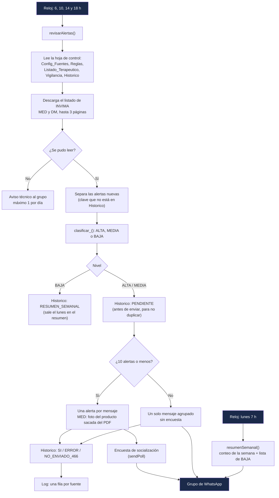

# Alertas WhatsApp - Alertas sanitarias INVIMA HDV

Bot de Google Apps Script del Servicio Farmacéutico del Hospital Departamental de Villavicencio E.S.E. (HDV). Revisa varias veces al día las **alertas sanitarias e informes de seguridad que publica INVIMA** (medicamentos y dispositivos médicos), decide cuáles son relevantes para el HDV y las publica en el grupo de WhatsApp vía [Green-API](https://green-api.com/en/), seguidas de una encuesta para que cada servicio confirme que socializó la información.

A diferencia de los otros bots, este **no depende de un formulario**: funciona por reloj y lleva su propio histórico en una hoja de control.

| Recurso | Enlace |
|---|---|
| Proyecto Apps Script | [alertas-sanitarias-invima-hdv](https://script.google.com/u/1/home/projects/1mKDd42COISvxqeunZtwUOYc025DG_ZqZSoDtcjeFQIhsw75xgb0TE1Za/edit) (independiente; cuenta `controldecalidadgases@hdv.gov.co`; archivo "Código") |
| Fuentes INVIMA | [Medicamentos y productos biológicos](https://app.invima.gov.co/alertas/medicamentos-productos-biologicos) · [Dispositivos médicos](https://app.invima.gov.co/alertas/dispositivos-medicos-invima) |
| Hoja de control | La indicada en la propiedad `SS_ID` |
| Código en este repo | `Codigo.gs` (copia del proyecto vivo, sincronizada el 2026-10-20) |

## Cómo funciona



Paso a paso de cada revisión (`revisarAlertas()`, a las 6, 10, 14 y 18 h, hora de Bogotá):

1. **Bloqueo.** Toma un `LockService` para que dos ejecuciones no se crucen; si ya hay una en curso, se salta esta.
2. **Lee la hoja de control:** fuentes activas, reglas de prioridad, Listado Terapéutico del HDV, principios en vigilancia y claves ya registradas en `Historico`.
3. **Descarga el listado** de cada fuente de INVIMA (página 0, 1, 2...). Sigue a la página siguiente solo si toda la página era nueva; si encuentra alertas ya conocidas, se detiene. Si una fuente no se puede leer, envía un **aviso técnico** al grupo (como máximo uno por día) y sigue con las demás.
4. **Identifica cada alerta** por una clave tipo `MED:AS:329-2026` (fuente : alerta o informe : número-año). Si la clave ya está en `Historico`, se ignora.
5. **Clasifica** cada alerta nueva según el título (ver abajo).
6. **Guarda antes de enviar.** Las BAJA quedan como `RESUMEN_SEMANAL`; las ALTA y MEDIA como `PENDIENTE`. Así, si la ejecución se corta, la próxima no las repite.
7. **Envía.** Si son 10 o menos, va un mensaje por alerta, de mayor a menor prioridad, con 2 s entre mensajes. Las de medicamentos llevan como imagen la foto del producto sacada del PDF de INVIMA, con el texto al pie; si no hay foto o falla, va como texto. Después de cada alerta enviada va la **encuesta de socialización**. Si son más de 10, va un solo mensaje agrupado y sin encuestas.
8. **Actualiza el estado** en `Historico` (`SI`, `ERROR` o `NO_ENVIADO_466`) y escribe una fila por fuente en `Log`. Si Green-API responde 466 (cupo agotado), no se reintenta y lo pendiente de esa ejecución queda como `NO_ENVIADO_466`.

Cada **lunes a las 7 h**, `resumenSemanal()` envía el conteo de la semana por fuente y nivel, y la lista de las alertas BAJA (hasta 40) con su enlace.

### Clasificación (prioridad)

Se compara el **título** de la alerta, en mayúsculas, sin tildes y en singular, contra las pestañas de la hoja de control:

| Nivel | Cuándo | Qué pasa |
|---|---|---|
| 🔴 **ALTA** | El título menciona un principio activo, marca o **lote dispensado** del `Listado_Terapeutico` del HDV, un principio de `Vigilancia` o un término ALTA de `Reglas` (p. ej. marcas comerciales de uso frecuente como BUSCAPINA) | Mensaje inmediato con "Coincidencia HDV" + encuesta |
| 🟠 **MEDIA** | Sin coincidencias ALTA ni término BAJA, pero con un término MEDIA de `Reglas` (falsificación, lote, retiro, calidad...), es un **informe de seguridad** o nombra un **laboratorio proveedor** del HDV | Mensaje inmediato + encuesta |
| ⚪ **BAJA** | Término BAJA de `Reglas` (comercio electrónico, suplementos, homeopáticos, CBD) o ninguna de las anteriores | Solo en el resumen semanal |

Para ajustar la prioridad **no hay que tocar el código**: basta con editar las pestañas `Reglas`, `Listado_Terapeutico` y `Vigilancia`.

### Ejemplo de alerta (ALTA, medicamento)

Va como foto del producto con este texto al pie:

```
[INVIMA-MED] 🔴 *PRIORIDAD ALTA* · 💊 Medicamento
*Alerta sanitaria No. 329-2026*

📌 FALSIFICACIÓN DEL PRODUCTO BUSCAPINA® COMPOSITUM NF TABLETAS RECUBIERTAS LOTE F0537A
📅 Detectada: 2026-10-20

🏥 *Coincidencia HDV:*
• BUSCAPINA COMPOSITUM: HIOSCINA+DIPIRONA 2.5G+20MG 5ML AMP (UT19959402-5)
• BUSCAPINA: HIOSCINA BUTIL BROMURO 20MG/ML AMP (UT225064-7) y 1 más
• Uso frecuente: BUSCAPINA

📄 PDF: https://app.invima.gov.co/alertas/ckfinder/userfiles/files/...
❓ Dudas: QF Juan Pablo Saavedra HDV · https://wa.me/573245844408

_Bot Alertas INVIMA · Servicio Farmacéutico HDV_
```

Inmediatamente después llega la encuesta.

## Encuesta de socialización

Después de cada alerta enviada de forma individual, el bot envía al mismo grupo una encuesta de WhatsApp (`sendPoll` de Green-API, una sola respuesta):

```
🔴 Alerta sanitaria No. 329-2026 (MED): ¿recibió y socializó esta información en su servicio?
( ) ✅ Recibida y socializada en mi servicio
( ) ⏳ Recibida, pendiente por socializar
```

- El círculo de color es el nivel de la alerta (🔴 ALTA, 🟠 MEDIA); los informes de seguridad dicen "Informe de seguridad No. …".
- WhatsApp exige al menos 2 opciones. Se configuran en `OPCIONES_ENCUESTA` (máximo 12, distintas entre sí); `ENCUESTA_ACTIVA = false` la apaga.
- No se envía si la alerta falló, ni con el mensaje agrupado, ni en `probarSinEnviar()` (allí solo se registra). `enviarPruebaAlerta()` sí la envía, para verla en PRUEBA BOT.
- Si la encuesta falla, la alerta sigue marcada como enviada; si responde 466, se detienen los envíos siguientes de esa ejecución.
- Las respuestas se ven en el propio WhatsApp; el bot no las lee ni las registra en la hoja.

## Hoja de control

`inicializarHoja()` crea estas pestañas con sus encabezados (no toca las que ya tienen datos) y precarga fuentes y reglas:

| Pestaña | Contenido | ¿Quién la edita? |
|---|---|---|
| `Config_Fuentes` | `fuente`, `url`, `activa` (MED y DM) | Servicio Farmacéutico, si INVIMA cambia una ruta |
| `Reglas` | `termino`, `nivel` (ALTA/MEDIA/BAJA), `motivo` | Servicio Farmacéutico |
| `Listado_Terapeutico` | Productos del HDV: código, descripción, principio activo, marca, tipo (MED/DM), lote, laboratorio | Servicio Farmacéutico |
| `Vigilancia` | Principios activos a vigilar aunque no estén en el listado | Servicio Farmacéutico |
| `Historico` | Una fila por alerta detectada: clave, título, PDF, nivel, coincidencia y estado `enviado` | El bot |
| `Log` | Una fila por fuente y ejecución: leídos, nuevos, enviados, estado, error | El bot |

Estados de `enviado` en `Historico`: `SI`, `PENDIENTE`, `ERROR`, `NO_ENVIADO_466` (cupo de Green-API agotado), `RESUMEN_SEMANAL` (BAJA) y `CARGA_INICIAL` (alertas viejas registradas sin enviar).

## Configuración (Propiedades del script)

En el editor de Apps Script: **Configuración del proyecto → Propiedades del script**. Ninguna credencial va en el código: este repositorio es público.

| Propiedad | Obligatoria | Descripción |
|---|---|---|
| `SS_ID` | sí | ID de la hoja de control |
| `GA_ID` | sí | ID de la instancia de Green-API (la misma de los otros bots) |
| `GA_TOKEN` | sí | Token de la instancia (secreto; nunca aparece en registros ni en la hoja) |
| `GA_API_URL` | sí | URL base de la API, ej. `https://7107.api.greenapi.com` |
| `GA_CHAT_ID` | sí | chatId del grupo; si no termina en `@g.us`, el envío se bloquea |
| `GA_MEDIA_URL` | no | Servidor para subir la foto; si falta, se deduce de `GA_API_URL` |
| `ULTIMO_AVISO_TECNICO` | (la escribe el bot) | Fecha del último aviso técnico, para enviar máximo uno por día |

Para encontrar el chatId de un grupo sin enviar nada: alguien escribe `ID BOT` en el grupo y se ejecuta `buscarIdGrupo()`, que lo busca en los mensajes recibidos en las últimas 24 h.

## Puesta en marcha (ya hecha)

`inicializarHoja()` → `cargaInicial()` (registra las alertas ya publicadas como `CARGA_INICIAL`, sin enviar) → `probarSinEnviar()` → `instalarDisparadores()` (borra los activadores del proyecto y crea los de las 6, 10, 14 y 18 h y el del lunes a las 7 h).

## Funciones

| Función | ¿Envía algo? | Uso |
|---|---|---|
| `revisarAlertas()` | Sí | Revisión normal; la llama el reloj |
| `resumenSemanal()` | Sí | Resumen del lunes; la llama el reloj |
| `probarSinEnviar()` | **No** | Todo el flujo con los mensajes en el registro; no escribe en `Historico` |
| `vistaPrevia()` | **No** | Muestra en el registro el mensaje de cada alerta de la página 0 |
| `enviarPruebaAlerta()` | **Sí** | Envía como "MENSAJE DE PRUEBA" la primera alerta ALTA (con foto y encuesta); usar solo con PRUEBA BOT |
| `inicializarHoja()`, `cargaInicial()` | **No** | Puesta en marcha |
| `instalarDisparadores()` | No (recrea activadores) | Solo si hay que reinstalar los relojes |
| `buscarIdGrupo()` | **No** | Encuentra el chatId de un grupo |
| `probarAcceso()`, `volcarMuestraHtml()`, `diagnosticarImagenesPdf()` | **No** | Diagnóstico del acceso a INVIMA y de las fotos de los PDF |

## Cómo se actualiza el bot

El editor de Apps Script **no** se sincroniza con GitHub. Para cambiar el bot:

1. Si solo cambian prioridades, productos o fuentes, editar la hoja de control; no hace falta tocar el código.
2. Para cambios de código, editar `Codigo.gs` en este repo y correr `npm test`.
3. Copiar el cambio al editor (archivo "Código", con la cuenta `controldecalidadgases@hdv.gov.co`) y guardar con Ctrl+S. No hace falta publicar: los relojes usan siempre la última versión guardada.
4. Probar con `probarSinEnviar()` y, si se quiere ver en WhatsApp, `enviarPruebaAlerta()` con `GA_CHAT_ID` en PRUEBA BOT.

Al pegar texto con tildes o emojis, el editor a veces los daña. Los textos nuevos se escriben con escapes `\u` o con `emoji_()`.

## Pruebas locales (sin red ni credenciales)

```bash
npm test   # test/dry-run.js (acceso a INVIMA y número de alerta) + test/encuesta.js (encuesta)
```

## Green-API compartida: cuidado con el cupo de chats

La instancia de Green-API es la misma para los 4 bots del Servicio Farmacéutico y está en el plan Developer (gratis). Ese plan **no limita mensajes, sino chats distintos por mes: 3**, contando los que escriben al número del bot; el contador se reinicia el día 1. Hoy se usan 2 (grupo de producción y PRUEBA BOT). La encuesta va al mismo grupo, así que no gasta cupo. Si se escribe a un cuarto chat, o alguien le escribe por privado al número del bot, Green-API responde 466 y **los 4 bots** dejan de enviar hasta el día 1. El enlace de "Dudas" (wa.me) abre el chat con el número personal del QF, no con el del bot, así que no cuenta.

| Bot | Qué lo dispara | Repositorio |
|---|---|---|
| Farmacovigilancia | Formulario FOREAM | [alertas-whatsapp-farmacovigilancia](https://github.com/jsaavedran1-glitch/alertas-whatsapp-farmacovigilancia) |
| Tecnovigilancia | Formulario FOREIA001 | [alertas-whatsapp-tecnovigilancia](https://github.com/jsaavedran1-glitch/alertas-whatsapp-tecnovigilancia) |
| PROA antimicrobianos | Formulario de antimicrobianos restringidos | [alertas-whatsapp-antimicrobianos](https://github.com/jsaavedran1-glitch/alertas-whatsapp-antimicrobianos) |
| Alertas INVIMA | Reloj (4 revisiones diarias) | este repositorio |

## Reglas

- **Solo a grupos.** `llamarGreenApi_()` es la única salida hacia Green-API y bloquea cualquier destino que no termine en `@g.us`.
- **Ninguna credencial en el código.** Todo vive en Propiedades del script; el token se oculta en registros y en la hoja.
- **Sin duplicados.** Una alerta se registra en `Historico` antes de enviarse; no borrar filas de `Historico` (la alerta se volvería a enviar).
- **Pruebas solo en PRUEBA BOT**, nunca en el grupo de producción.
